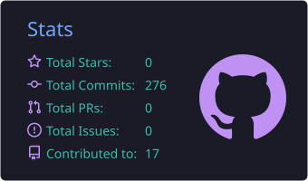
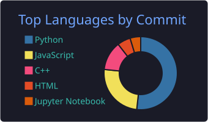
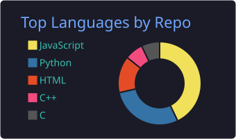
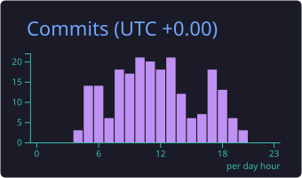

  

<h1 align="center">Hi 👋, I'm Manaal Pervaiz</h1>

<h3 align="center">
  
</h3>

  

## 💡 About Me

- 🧠 **LLM Engineer @ CloudPilot UK**: enterprise RAG architecture (PostgreSQL/pgvector, self-hosted Llama via vLLM) + MCP-based governance workflows
- 🛡️ Built **AURA Shield**: auditable prompt-injection detection gateway · 330-prompt benchmark · 210 passing tests
- 🤖 Architected **AURA OS**: 10-agent orchestration platform · nationally shortlisted, Google AI Seekho Hackathon
- 🎙️ Shipped a real-time voice AI agent (WebSocket + Deepgram + Groq) with sub-200ms demo latency
- 💼 **AI Automation Engineer**: WhatsApp bots, voice agents, email automation & AI receptionists for international clients
- 🔬 **AI Researcher & Leading Team Member @ Afrium**: EEG/BCI calibration-efficiency benchmarks (ranked 2nd, 97/100 in the research assessment)
- ⚡ **BS Embedded Systems @ University of Lahore**: CGPA 3.93/4.0 · firmware/IoT paired with edge AI and cloud backends
- 🤝 Core Team @ Techno Club UoL · Head of Digital Media @ Pakistan Health Parliament

> 💭 **"I think about AI systems the way I think about hardware: constraints, failure modes, and what happens when nobody's watching it run."**

📫 **Contact:** manaalpervaiz3@gmail.com

## 🌐 Let's Connect

  
  
  
  
  

## 🛠️ Tech Arsenal

### 🧠 LLMs, Agents & AI

  
  
  
  
  
  
  
  
  

### ⚙️ Backend & Databases

  
  
  
  
  
  
  
  
  

### 🔌 Automation & Integrations

  
  
  
  
  
  
  

### 🔩 Embedded, IoT & Edge AI

  
  
  
  
  
  
  

### 🔬 Research & ML

  
  
  
  
  
  
  
  

### ☁️ Cloud & DevOps

  
  
  
  
  

## 🚀 Featured Projects

| Project | What it does | Stack |
|---|---|---|
| 🛡️ **[AURA Shield](https://github.com/manaal6/Aura-Shield)** | Auditable inference-time gateway for prompt-injection detection: deterministic rules + TF-IDF similarity + LLM semantic analysis, a versioned constitution, and allow/review/block enforcement. 330-prompt benchmark, 210 tests passing | Python · FastAPI · React · Docker · PostgreSQL |
| 🤖 **[AURA OS](https://github.com/manaal6/AURA-OS-Autonomous-Operational-Survival-System)** | 10-agent, event-driven platform that resolves enterprise supply-chain crises autonomously. **Nationally shortlisted, Google AI Seekho Hackathon** | Python · Groq · LangChain · WebSocket · Docker · AWS |
| 📄 **[AI Document Intelligence](https://github.com/manaal6/ai-document-intelligence)** | Full-stack RAG app: upload PDF/DOCX/TXT, source-backed answers, auto-summaries, structured extraction, PDF/JSON export. One-command Docker Compose deploy | React · FastAPI · ChromaDB · Groq (Llama 3.1) |
| 🎙️ **[Real-Time Voice Agent](https://github.com/manaal6/autonomous-ai-voice-agent-system)** | Full-duplex voice AI (STT → LLM → TTS) with interruption handling, CRM capture, and sub-200ms demo latency | Node.js · WebSocket · Deepgram · Groq |
| 🦷 **[Dental Clinic AI Receptionist](https://github.com/manaal6/dental-ai-agent)** | 24/7 voice receptionist that captures caller name, phone, and treatment and logs leads to a dashboard | Node.js · REST · real-time voice |
| 💬 **[Multilingual WhatsApp AI Agent](https://github.com/manaal6/multilingual-whatsapp-ai-agent)** | English/Urdu conversational backend handling text + voice notes via WhatsApp Business API | Node.js · Webhooks · LLMs |
| 📧 **[Email Intelligence Agent](https://github.com/manaal6/aura-email-intelligence-agent)** | LLM email automation API handling 50+ daily B2B requests with ~80% less manual handling | Python · Flask · Groq · Gmail API · Railway |
| 👁️ **[LensIQ AI](https://github.com/manaal6/LensIQ-AI)** | Vision pipeline: object detection + OCR + LLM summarization and natural-language Q&A | OpenCV · YOLO · OCR · Streamlit |
| 📷 **[ESP32-CAM AI Surveillance](https://github.com/manaal6/ESP32CAM_AI_Surveillance_System)** | Motion detection + face recognition with Firebase cloud events and real-time mobile alerts | ESP32-CAM · Raspberry Pi · OpenCV · Firebase |
| 🅿️ **[Embedded Systems Projects](https://github.com/manaal6/BS-Embedded-Systems-Projects)** | IoT smart parking (ESP32 + ultrasonic/IR + ThingSpeak) and STM32 libraries | ESP32 · STM32 · Embedded C/C++ |
| 📊 **[Global Economic Explorer](https://github.com/manaal6/Global-Economic-Explorer)** | IMF WEO analytics dashboard: 8,200-row dataset reshaped to long format, with anomaly screening and forecast views | Python · Pandas · Streamlit |
| 🧬 **EEG / BCI Research** | Leakage-safe, cross-subject imagined-speech decoding benchmark: 4 models (EEGNet, EEGConformer, CBraMod, LaBraM), 15 subjects × 25 seeds, all only 1.4–2.4 pts above chance. Extended to FEIS, KaraOne, Inner Speech. Paper draft in progress | PyTorch · braindecode · SciPy · pytest |

## 🧭 Experience & Leadership

| Role | Where | Focus |
|---|---|---|
| **LLM Engineer** | CloudPilot UK · Remote | Enterprise RAG (pgvector + vLLM), MCP governance workflows |
| **AI Automation Engineer** | Fiverr · Remote | Voice agents, WhatsApp bots, email automation, AI receptionists for international clients |
| **AI Researcher & Leading Team Member** | Afrium | Promoted from Founding Campus Ambassador (500+ applicants); EEG/BCI + LLM evaluation research |
| **Core Team Member** | Techno Club, University of Lahore | Robotics & Embedded Systems, event planning |
| **Head of Digital Media** | Pakistan Health Parliament | Led campaigns reaching 5,000+ students; +45% engagement |
| **Generative AI Intern** | InventaCore AI | Document intelligence assistant + lead automation system |
| **AI Intern** | DecodeLabs | 3 LLM-based automation solutions in a 4-week program |
| **Chip Design Intern** | University of Lahore | Applied embedded coursework to chip-design fundamentals |

## 🏆 Recognition & Certifications

- 🥇 **Nationally shortlisted**, Google AI Seekho 2026 Hackathon (AURA OS)
- 🌍 **National Delegate**, AWS Student Community Day
- 🎓 **Anthropic:** Claude Code in Action · Claude Code 101 · AI Fluency for Students
- 📘 **Afrium:** ML Class Certificate of Completion · Ambassador Certificate of Appreciation
- 🎤 **GDG Lahore:** AI Connect 2026
- 🍓 **UC Irvine:** Raspberry Pi & Python Programming · **Microsoft:** Cloud Fundamentals (Certiport)

## 📊 GitHub Stats

  
  

  
  

## 🤝 Open To

- 🔹 AI / LLM engineering roles and internships (RAG, agents, voice AI)
- 🔹 Embedded + edge-AI projects where hardware meets LLMs
- 🔹 AI research collaborations (EEG/BCI, LLM evaluation, healthcare AI)
- 🔹 Custom AI automation for businesses still handling leads, calls, or support by hand

  <picture>
    <source media="(prefers-color-scheme: dark)" srcset="https://capsule-render.vercel.app/api?type=waving&color=0f2027,203a43,2c5364&height=100&section=footer" />
    
  </picture>

